# Reprise

Reprise is a voice assistant built for **Samsung PRISM Theme 05: Interruptible Real-Time Agents**. It uses Gemini Live for speech, LiveKit for audio transport, and a local action controller to coordinate tool execution as the user pauses, interrupts, or changes a request.

The working extension manages a connected Google Workspace account. The Samsung Galaxy AI/Bixby integration is a product direction; native Galaxy Clock, Samsung Reminder, and Bixby integration are not implemented in this release.

## Current application

| Area | Implemented capability |
| --- | --- |
| Conversation | Bidirectional voice, live user/assistant transcripts, typed input, microphone/session controls |
| Gmail | Search/read messages, source-grounded booking fields, save unsent drafts, send with confirmation |
| Google Tasks | List/search/read, create, edit title/notes/due date, complete/reopen, delete with confirmation |
| Google Calendar | List/search/read the configured calendar, create, edit/reschedule, reminder settings, delete with confirmation |
| Corrections | Suppress stale proposals before dispatch; update existing Calendar/Task resources using confirmed Google IDs after dispatch |
| Execution | Contextual consent, duplicate coalescing, persistent receipts, conditional updates and explicit unknown outcomes |

Shopping entries are Google Tasks checklist items. Task due dates do not schedule timed notifications. Calendar reminder settings can be saved, but delivery of a notification is not verified by an API receipt. Gmail sending has no automatic undo. See [Workspace behavior and manual checks](docs/PRODUCTIVITY.md).

## Architecture

```mermaid
flowchart LR
    Browser[Browser: microphone and speaker] <-->|WebRTC audio| LiveKit[LiveKit room]
    LiveKit <-->|Audio tracks| Worker[Python LiveKit agent]
    Worker <-->|Streaming audio and model events| Gemini[Gemini Live]
    Gemini -->|Tool proposals| Controller[Reprise action controller]
    Worker -->|Speech and transcript events| Controller
    Controller -->|Validated settled operations| Workspace[Workspace backend and SQLite ledger]
    Workspace <-->|OAuth REST requests and receipts| Google[Gmail / Calendar / Tasks]
    Workspace -->|Actual results| Controller
    Controller -->|Tool responses via worker| Gemini
    LiveKit -->|Live transcripts| UI[Conversation panel]
    Controller -->|Correlated events| Server[Local FastAPI event feed]
    Server --> Actions[Actions & Status panel]
```



- **Revisions and settlement:** audio and typed input share an intent-revision path. Committed transcript state, acoustic speech state and configurable settlement intervals gate dispatch. An elapsed timeout is not authorization to execute an unfinished request.
- **Stale-action suppression:** a genuine correction invalidates uncommitted work. Interrupting assistant speech alone does not cancel valid user intent. Dispatched writes retain their actual outcome.
- **Asynchronous execution:** tool preparation and HTTP requests run as async tasks while the voice session remains active. The controller retains dispatch ordering and dependencies for state-changing operations; results are returned through Gemini Live's non-blocking tool flow.
- **Duplicate prevention:** the controller coalesces equivalent in-flight proposals. The Workspace ledger claims each plan and remote resource, retains completed receipts, and blocks blind retries of uncertain writes. These safeguards do not provide a cross-service transaction or an unconditional exactly-once guarantee.

The stack is Python 3.12, LiveKit Agents with the Google plugin, Gemini Live (configured default `gemini-3.8-live`), FastAPI/Uvicorn, HTTPX and SQLite. The browser uses plain JavaScript and the pinned LiveKit client, not a frontend framework. Dependency versions are recorded in `uv.lock` and `demo/package-lock.json`. [Architecture details](docs/ARCHITECTURE.md) explain state ownership and lifecycle boundaries.

## Install and configure

Requirements: Git, Python 3.12, [uv](https://docs.astral.sh/uv/getting-started/installation/), Node.js/npm, a Gemini API key with access to the configured Live model, and a LiveKit Cloud project. Hosted inference does not require a local GPU. FFmpeg is needed for the separate FDB audio benchmark workflow.

```sh
git clone https://github.com/naithick/Prism.git
cd Prism
uv sync --frozen
npm ci --prefix demo
cp .env.example .env.local
```

Fill `.env.local` with your own values:

| Variable | Purpose |
| --- | --- |
| `GOOGLE_API_KEY` | Gemini Live inference; one model key is sufficient for the demo |
| `GEMINI_MODEL` | Live model available to that project; default `gemini-3.8-live` |
| `LIVEKIT_URL` | LiveKit project's `wss://` URL |
| `LIVEKIT_API_KEY`, `LIVEKIT_API_SECRET` | Server credentials for that project |
| `GOOGLE_OAUTH_CLIENT_ID`, `GOOGLE_OAUTH_CLIENT_SECRET` | Google OAuth Web application credentials for Workspace |
| `GOOGLE_OAUTH_REDIRECT_URI` | `http://127.0.0.1:8844/google/callback` |
| `GOOGLE_CALENDAR_ID`, `GOOGLE_TASK_LIST_ID` | Default `primary` calendar and `@default` task list |
| `REPRISE_TIME_ZONE` | Timezone for relative dates and Calendar times; default `Asia/Kolkata` |

Keep `REPRISE_POLICY=guarded`. The template documents settlement settings and optional shopping-list configuration. Environment variables take precedence over `.env.local`, which takes precedence over `.env`; neither file is committed. Gemini API credentials and Workspace OAuth credentials serve different purposes.

### Google OAuth setup

1. In Google Cloud, enable **Gmail API**, **Google Calendar API**, and **Google Tasks API**.
2. Configure the OAuth consent screen. When using testing mode, add the account used for the demo as a test user.
3. Create an OAuth client with application type **Web application** and register the exact redirect URI above. Copy its client ID and secret into `.env.local`.
4. Launch the app, click **Connect Google**, and complete sign-in/consent for `gmail.readonly`, `gmail.compose`, `calendar.events`, and `tasks` access. Reconnect if an older grant lacks Gmail read permission.

OAuth state and PKCE are checked during connection. Tokens are stored in the ignored `.google-workspace-token.json` with owner-only permissions and refreshed by the backend. Google testing/verification restrictions still apply to the OAuth project. [OAuth setup details](docs/PRODUCTIVITY.md#account-setup).

## Run the live demo

Start both processes from the repository root in separate terminals:

```sh
# Terminal 1: Gemini Live / LiveKit agent worker
./reproduce.sh agent
```

```sh
# Terminal 2: local dashboard and OAuth endpoints
./reproduce.sh demo
```

The wrapper synchronizes the frozen Python dependencies before launching. The demo does not require downloading FDB or its recordings. Open **http://127.0.0.1:8844/**, connect Google, choose **Start conversation**, permit microphone access, and wait for both **LiveKit** and **Gemini** to show connected. Use headphones or an echo-controlled microphone. If browser audio playback is blocked, interact with the page to enable it.

The interface has exactly two main information panels:

- **Conversation:** live/final user and assistant transcripts with speaker labels and timestamps.
- **Actions & Status:** actual tool arguments, retrieved items, corrections, supersession, dispatch, receipts, failures and unknown outcomes. The current plan and any required confirmation stay inside this panel.

Use disposable Google objects for manual writes. Ask to read tasks or events first, then create an item, correct it before dispatch, and reschedule or edit it after completion. Check that post-dispatch edits retain the same Google ID. Deletion and invitations must wait for contextual confirmation; personal creation and ordinary reversible edits execute after intent settles. [Exact manual checklist](docs/WORKSPACE_MANAGEMENT.md#manual-testing-checkpoint).

## Verification and operation

```sh
# Offline unit/integration tests (Google HTTP is mocked)
uv run --frozen pytest -q tests/test_coordinator.py tests/test_controller_regressions.py tests/test_controller_safety.py tests/test_intent_state.py tests/test_productivity.py tests/test_workspace_recovery.py tests/test_action_corrections.py tests/test_gmail_reads.py tests/test_workspace_management.py tests/test_demo_events.py tests/test_tracing.py tests/test_provider_contract.py
node demo/app.test.cjs
```

Controller tests using the public mock tools require `./reproduce.sh setup` once. This fetches the pinned FDB source; `--data` is unnecessary for these tests. Setup does not run voice inference. Runtime artifacts stay local under ignored `runs/`; events can contain private transcripts and account content. The demo server binds to loopback and is intended for a local, single-user demo.

[Execution safety](docs/HARDENING.md) documents consent, uncertain outcomes, corrections and restart handling. [FDB reproduction](docs/BENCHMARK.md) retains the Theme 05 evaluation commands and explicitly separates exact scoring from semantic judging. This demo release adds no new benchmark score claim or generated evaluation reports. [Roadmap](docs/ROADMAP.md) preserves the next Galaxy Clock and combined-demo phases without starting them.

## Main source files

| Path | Responsibility |
| --- | --- |
| `src/reprise/agent.py`, `session_events.py`, `speech.py` | Gemini/LiveKit session, transcripts, speech events and audio activity |
| `src/reprise/coordinator.py`, `intent.py` | Revision, validation, settlement, cancellation and tool ledger |
| `src/reprise/productivity.py`, `workspace_management.py` | Persistent plans, policy, lookup-bound resource changes |
| `src/reprise/google_workspace.py`, `gmail_content.py` | OAuth, Google REST and bounded message extraction |
| `src/reprise/demo_server.py`, `demo/` | Local API, two-panel interface and live updates |

Built on [LiveKit Agents](https://docs.livekit.io/agents/), [Gemini Live](https://ai.google.dev/gemini-api/docs/live), and the public [Full-Duplex-Bench v3](https://github.com/DanielLin94144/Full-Duplex-Bench/tree/main/v3). Benchmark implementation and data remain separate from the Workspace extension.
