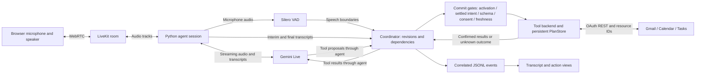

# Reprise

Reprise is a realtime voice agent that coordinates actions while people pause, interrupt, and correct themselves. It was developed for Samsung PRISM Theme 05, **Interruptible Real-Time Agents**.

A conversational model can propose an action before a request is finished, or continue acting on a destination, time, or recipient the user has just changed. Reprise separates model proposals from execution. Its Coordinator tracks intent revisions, waits for committed input, suppresses stale work, and records what actually happened at the tool boundary.

The current application uses **Gemini Live**, **LiveKit**, and real **Google Workspace APIs**. It runs locally with a browser microphone. It does not control Samsung's cellular calls, Bixby, or system AI.

## Implemented capabilities

| Component | Current behavior |
|---|---|
| Voice session | Streaming audio, user/assistant transcription, typed input, microphone and playback controls |
| Gmail | Search and read messages, extract source-grounded booking information, save drafts, send with contextual confirmation |
| Calendar | List/search/read, create, reschedule/update, configure supported reminders, delete with confirmation |
| Tasks | List/search/read, create, edit, complete/reopen, delete with confirmation |
| Corrections | Invalidate affected pending actions; retain unaffected lookups; update supported existing resources using real returned IDs |
| Execution ledger | Persistent plans, resource claims, duplicate coalescing, verified receipts and explicit uncertain outcomes |
| Call listening | Optional deterministic standby/activation gate; shared-microphone transcripts do not imply speaker identity |

Reading and ordinary reversible creation/edits run after intent settles. Sending email, invitations, deletion, and consequential changes require contextual consent. An interrupted assistant response does not itself cancel valid user intent. Already dispatched requests retain their outcome; Reprise does not pretend to cancel them retroactively or automatically undo sent email.

Google Tasks due dates are date-only, not timed reminders. Samsung Calendar can display the connected Google Calendar through account synchronization; Google Tasks is not Samsung Reminder. Device visibility and notification delivery require separate verification.

## Architecture



- **Commit gates:** acoustic silence alone is not authorization. Final transcript state, intent revision, settlement windows, schema validation, prerequisites, and risk policy determine whether a proposal may dispatch.
- **Selective recovery:** corrections invalidate affected proposals and dependent results. Valid read results can remain useful within the session; a complete goal change discards irrelevant pending work.
- **Concurrency:** preparation and HTTP requests are asynchronous. Conflicting mutations preserve causal order; unrelated operations need not wait for one another.
- **Resource identity:** updates and deletion use lookup-bound resource references or saved plan/action receipts. Ambiguous names require clarification.
- **Duplicate and failure handling:** equivalent in-flight proposals coalesce. Persistent leases and resource claims protect Workspace writes. Unknown outcomes require reconciliation rather than blind retries. These are safeguards, not a cross-service transaction or unconditional exactly-once guarantee.
- **Traceability:** events correlate input revisions, raw proposals, validation, dispatch, HTTP outcomes, receipts, and assistant responses. Timing clocks and unavailable measurements are identified explicitly.

See [architecture](docs/ARCHITECTURE.md), [execution safeguards](docs/HARDENING.md), and [Workspace behavior](docs/WORKSPACE_MANAGEMENT.md).

## Stack and repository layout

Python 3.12; LiveKit Agents with the Google plugin; Gemini Live; Silero VAD; FastAPI/Uvicorn; HTTPX; SQLite; plain HTML/CSS/JavaScript with a pinned LiveKit browser client. Python and browser dependencies are locked in `uv.lock` and `demo/package-lock.json`.

```text
src/reprise/
  agent.py, session_events.py, speech.py    Voice transport, events and VAD
  coordinator.py, intent.py                Intent revisions and execution ledger
  productivity.py, workspace_management.py Plans, consent and resource operations
  google_workspace.py, gmail_content.py    OAuth, REST and message extraction
  call_activation.py                      Deterministic call-listening gate
  evaluation.py, metrics.py                FDB runner, scoring and diagnostics
  demo_server.py                          Local API and frontend serving
  local_planner.py                        Optional experimental text planner
demo/                                     Existing browser frontend
tests/                                    Controller and integration tests
evidence/fdb-v3-20261019/                   Reviewed historical evaluation records
docs/                                     Setup and implementation references
runs/, data/, third_party/                 Local runtime/downloads; ignored
```

The optional llama.cpp/Gemma planner is text-only and experimental. It proposes existing tools through the same controller; it is not a replacement for Gemini Live or a full-duplex speech implementation. [Local setup](docs/LOCAL_PLANNER.md).

## Installation

Prerequisites: Git, Python 3.12, [uv](https://docs.astral.sh/uv/getting-started/installation/), Node.js/npm, a Gemini API project with access to the configured Live model, and LiveKit credentials. The launcher targets Linux and uses `bash`, `flock`, `curl`, and `setsid`. FFmpeg is needed for FDB audio evaluation. Hosted voice inference needs no local GPU.

```sh
git clone https://github.com/naithick/Prism.git
cd Prism
uv sync --frozen
npm ci --prefix demo
cp .env.example .env.local
```

Configure `.env.local`:

| Variable | Purpose |
|---|---|
| `GOOGLE_API_KEY` | Gemini Live inference key |
| `GEMINI_MODEL` | Available Live model; recorded/default configuration is `gemini-3.8-live` |
| `LIVEKIT_URL` | LiveKit `wss://` endpoint |
| `LIVEKIT_API_KEY`, `LIVEKIT_API_SECRET` | LiveKit server credentials |
| `GOOGLE_OAUTH_CLIENT_ID`, `GOOGLE_OAUTH_CLIENT_SECRET` | Workspace OAuth Web application credentials |
| `GOOGLE_OAUTH_REDIRECT_URI` | `http://127.0.0.1:8844/google/callback` |
| `GOOGLE_CALENDAR_ID`, `GOOGLE_TASK_LIST_ID` | Defaults: `primary`, `@default` |
| `REPRISE_TIME_ZONE` | Relative-date timezone; default `Asia/Kolkata` |
| `REPRISE_POLICY` | Keep `guarded` for normal operation |

The template also records settlement, latency-profile, and optional local-planner settings. Environment variables override `.env.local`, which overrides `.env`. Model availability is account-dependent; the agent does not silently substitute another provider.

### Google OAuth

1. Enable Gmail API, Google Calendar API, and Google Tasks API in Google Cloud.
2. Configure the consent screen and add your account as a test user if the project is in testing mode.
3. Create a **Web application** OAuth client and register the exact redirect URI above.
4. Start Reprise, open Settings → **Connect Google**, and grant the requested access: `gmail.readonly`, `gmail.compose`, `calendar.events`, and `tasks`.

The backend checks OAuth state and PKCE. Tokens are refreshed server-side and stored with owner-only permissions in the ignored `.google-workspace-token.json`. Testing-mode expiry and Google's verification requirements still apply. Never publish OAuth token files, `.env` files, or downloaded client credentials.

## Run

From the repository root:

```sh
./start-reprise.sh
```

The launcher starts the local server and agent worker, checks readiness, and opens **http://127.0.0.1:8844/**. Repeated launches reuse running processes; restart both services after backend code changes. Logs are under `runs/launcher/`.

Alternatively, run these in separate terminals:

```sh
./reproduce.sh agent
./reproduce.sh demo
```

Select **Live**, start a conversation, allow microphone access, and wait for LiveKit and Gemini connection status. The Conversation view contains actual transcripts; action cards/history show proposals, corrections, dispatch, results, and failures. Start with a read-only request, such as listing tomorrow's calendar. Use disposable objects when checking writes, and verify the returned resource ID before and after an edit. Headphones help avoid microphone feedback. The presentation frontend remains available, but scripted playback is separate from real execution.

## Full-Duplex-Bench v3

Reprise retains the upstream 12-tool mock benchmark separately from real Workspace actions. Upstream source is pinned to [`3e799c45a045256f47d5f1c9cda90157e2d2ec9e`](https://github.com/DanielLin94144/Full-Duplex-Bench/tree/3e799c45a045256f47d5f1c9cda90157e2d2ec9e/v3).

Historical **local** results on the same 100 released recordings:

| Metric | Original saved inference | Repaired controller inference |
|---|---:|---:|
| Strict tool pass | 77/100 | **78/100** |
| Tool-selection precision, micro | 97.26% | 99.31% |
| Tool-selection recall, micro | 94.67% | 96.00% |
| Tool-selection F1, micro | 95.95% | **97.63%** |
| Strict argument accuracy, expected-call weighted | 83.33% | **81.33%** |
| Gemma-judged semantic tool pass | 77/100 | 82/100 |
| Gemma-judged argument accuracy | 84.00% | 84.67% |
| Gemma-judged spoken-response correctness | 92/100 | 93/100 |

Both used Gemini Live `gemini-3.8-live`; repaired inference used guarded policy, concurrency 2, 1,000 ms settlement and 900 ms write settlement. Selection F1 uses matched/expected/actual call counts; repaired counts are 144/150/145. Strict argument accuracy assigns zero to missing expected calls and uses upstream function/order pairing. Strict pass requires the expected tool calls and matching arguments, with successful execution and no terminal infrastructure failure. Spoken-response correctness is separate from tool pass.

Semantic scores used **`gemma-4-26b-a4b-it`**, the same upstream criteria and judge settings for both versions, with no exact-match fallback. These are **Gemma-judged, not official GPT-4o results**. Three original response transcripts were missing and received zero response scores. The repaired run had no terminal infrastructure failures; an initial client crash was retried and retained. Original inference had two terminal infrastructure failures.

These scores describe preserved historical artifacts, **not the latest release commit**. The original inference was reused; repaired inference was fresh and nondeterministic. The one-case strict difference does not establish controller causation, and strict argument accuracy decreased. Official aligned audio-response/task-completion latency was not measured. The evidence bundle includes configuration/input hashes, case outcomes, metric reports, and the historical source snapshot; private sessions and raw audio remain excluded. [Evidence and limitations](evidence/fdb-v3-20261019/README.md).

### Reproduction

```sh
# Fetch pinned upstream source; add --data to download released recordings
./reproduce.sh setup --data

# Explicit full voice evaluation: uses Gemini/LiveKit resources
./reproduce.sh all --model gemini-3.8-live --seed 20260927 \
  --concurrency 2 --name YOUR_UNIQUE_RUN

# Offline strict/continuous scoring of a saved runner output directory
uv run --frozen reprise score runs/YOUR_UNIQUE_RUN --provider reprise

# Optional upstream GPT-4o semantic scoring: requires OPENAI_API_KEY; may incur costs
uv run --frozen reprise score runs/YOUR_UNIQUE_RUN --provider reprise --use-llm

# Controller/SDK diagnostics; no inference
uv run --frozen reprise metrics runs/ROOM/events.jsonl --output runs/ROOM/metrics.json
```

Do not run a separate agent worker on the same LiveKit project during `all`; that command starts its own worker. A current-code rerun exercises the current implementation and need not reproduce a historical score exactly. Upstream semantic scoring can fall back to exact matching on judge errors: inspect diagnostics rather than labeling every returned score as judged. The historical Gemma comparison adapter is archived with its source; it is not the default `score --use-llm` path. [Detailed methodology](docs/BENCHMARK.md).

## Tests and operational limits

```sh
./reproduce.sh setup                  # Pinned mock-tool source; no voice inference
uv run --frozen pytest -q
node --test --test-isolation=none demo/activation.test.cjs demo/phone.test.cjs
```

Python tests isolate Google HTTP; they do not prove live account behavior or phone synchronization. The older `demo/app.test.cjs` fake-DOM harness predates the current layout and cannot initialize it (`document.querySelector` is missing). It remains preserved for migration; browser/microphone acceptance is still required.

- This is a local single-user application, not a hardened multi-tenant deployment.
- Mixed microphone audio does not reliably identify speakers. Wake phrases do not establish owner authority; consequential actions retain consent requirements.
- Gemini input finalization can arrive after generation, adding activation/settlement latency. Deterministic gates use available transcripts; transcription mistakes remain possible.
- Restart recovery records uncertainty when remote execution cannot be proved. Automatic reconciliation is limited by each API's resource identity and lookup support.
- Runtime JSONL, SQLite and audio artifacts can contain account content and private conversation. They stay ignored; retain and protect them locally.
- Live microphone acceptance of the latest activation fix remains pending. No new paid benchmark or real Google mutation was performed for this publication.

## Future scope — Samsung Galaxy integration

**Implemented today.** Reprise runs as a browser/LiveKit agent and manages Google Workspace through OAuth. Google Calendar account synchronization can expose its events in Samsung Calendar, but this is not a Samsung system integration. There is no native-call capture, Bixby control, or Samsung AI API adapter.

**Documented interfaces.** Samsung's [Automation Studio](https://developer.samsung.com/automation/index.html) documents flows connecting Bixby, SmartThings, and external HTTPS APIs. Its [Bixby capsule integration](https://developer.samsung.com/automation/v2-sasm-capsule.html) could expose a Reprise endpoint while retaining controller validation, revision checks, consent, and receipts. This is an integration route to investigate, not a verified deployment: the site describes a beta service with account, developer enrollment, and subscription-code prerequisites. Current regional access and supported devices must be confirmed.

**Samsung cooperation or privileged access.** [Galaxy Call Assist and Live Translate](https://www.samsung.com/us/support/answer/ANS10007435/) provide relevant call experiences; supported devices also offer recorded-call transcripts and summaries. With an authorized integration, these could supply conversation context for interruption-aware assistance. Consumer support documentation does not establish a public third-party streaming transcript or cellular-audio interface. Access to live calls and reliable speaker authority would need explicit platform support and participant consent.

Samsung describes [Now Nudge and Now Brief](https://www.samsung.com/us/apps/one-ui/) as contextual actions and personalized briefings. Reprise's contribution could be checking that a suggestion still matches the latest instruction before dispatch, then surfacing a confirmed result. The [Now Bar](https://www.samsung.com/ph/support/mobile-devices/how-to-use-the-now-bar-on-the-lock-screen-of-your-samsung-galaxy-device/) displays supported ongoing activities; showing Reprise operations there would require an eligible notification integration, not arbitrary injection into Samsung's surfaces. Deep integration with these features or Bixby's device actions would require documented eligibility or Samsung cooperation.

Within **Galaxy AI / One UI**, a future on-device planner could reuse the same execution boundary. The current small-model experiment is text-only and has not matched the hosted baseline's reliability. System-level deployment, on-device voice, and access to Samsung's personal context remain future work, dependent on hardware, permissions, and available platform interfaces.
